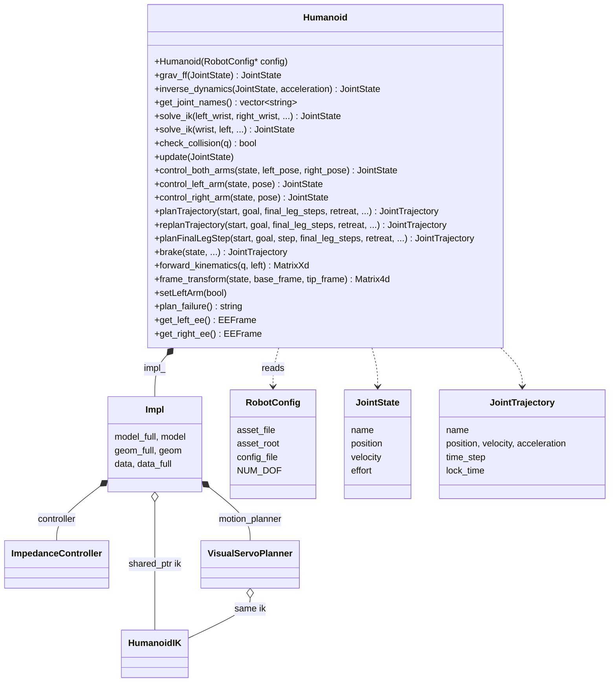
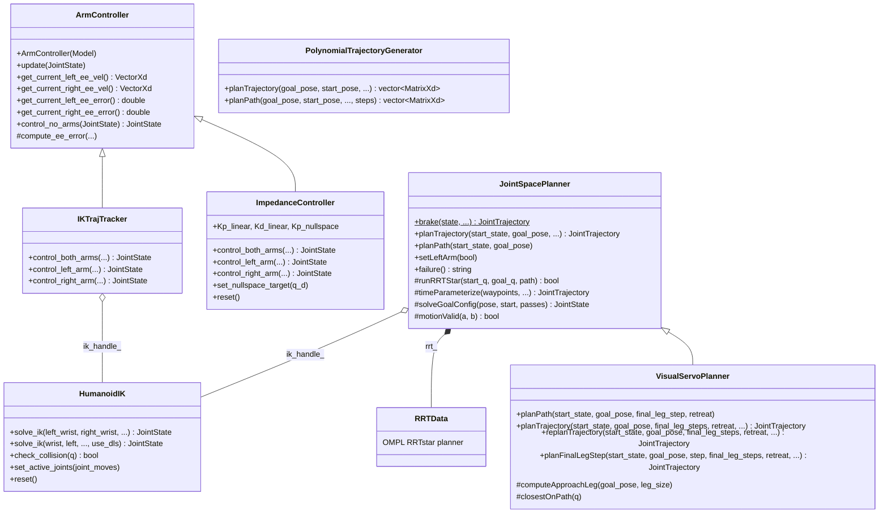
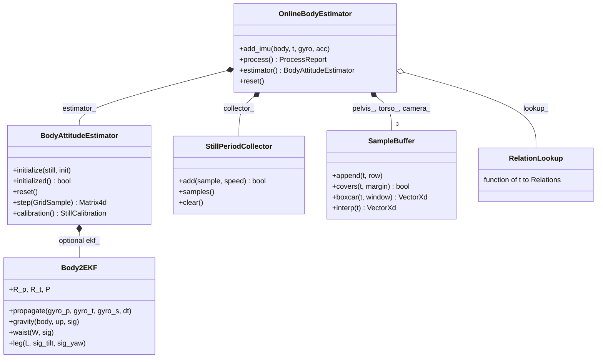
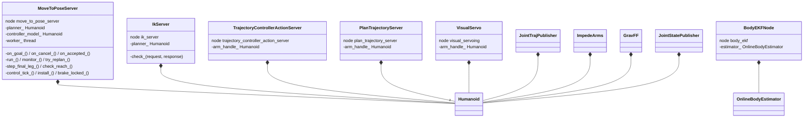
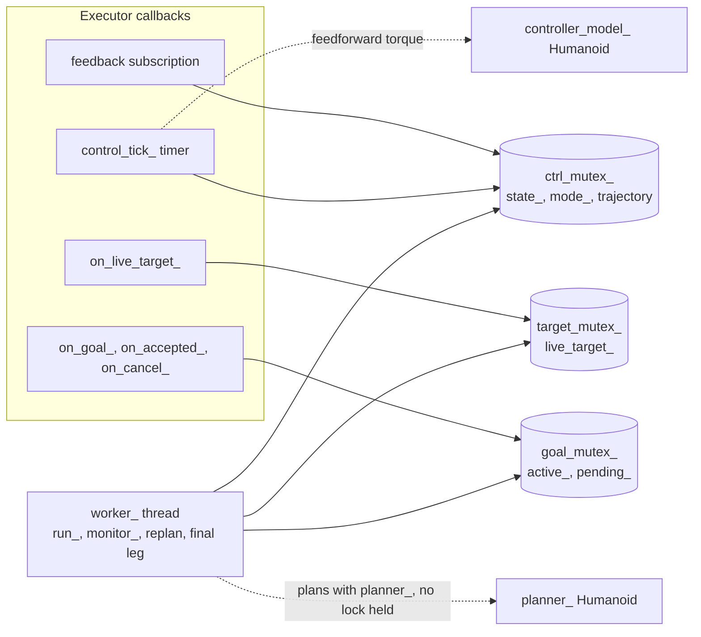
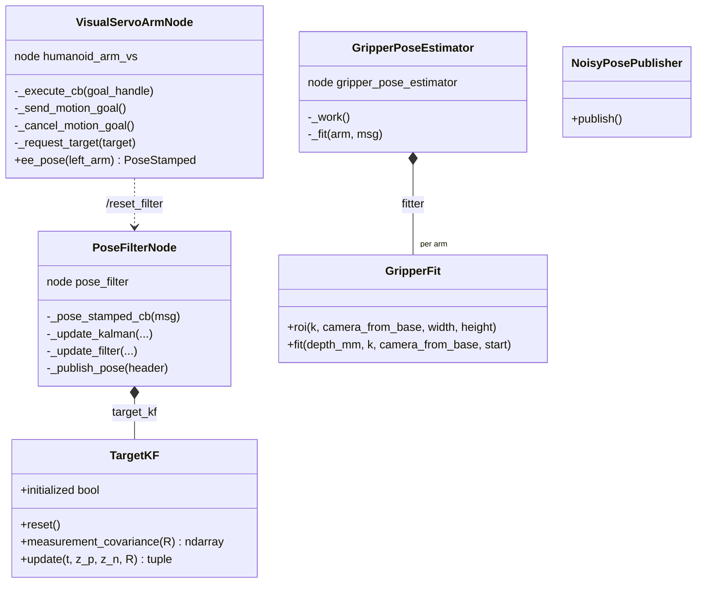

# Classes and ownership

The C++ classes of `g1_pilot`, who owns which, and the base classes between the parts. The Python nodes close the page; their full API is in the API reference.

## The Humanoid facade

`Humanoid` is the one public class of `libg1_pilot`. Every node talks to the library through it, and a private `Impl` owns the solvers.

`Impl::initialize` builds one `HumanoidIK` and hands it to the planner. The planning calls, `brake`, `setLeftArm` and `plan_failure` all forward to that one `VisualServoPlanner`.

## Controllers and planners

Two small hierarchies sit under the facade. Both share the IK solver by `shared_ptr`.

`HumanoidIK` solves with CasADi and checks self-collision with pinocchio geometry. `PolynomialTrajectoryGenerator` is compiled into the library, but no node or class uses it.

## Body attitude EKF

The `body_ekf` node owns one `OnlineBodyEstimator`. It resamples the IMUs on a grid and feeds the filter.

The node supplies `RelationLookup` as a TF lookup of the waist and leg relations. The still-period collector decides when calibration ends and the EKF starts.

## ROS nodes

Each node owns its own `Humanoid` instances. `MoveToPoseServer` holds two, so planning and control never share pinocchio data.

The default node names above come from the constructors. Launch files rename some: `joint_controller` runs as `trajectory_controller`, and `plan_trajecory` as `plan_trajectory_server`.

## MoveToPoseServer threads and locks

Three mutexes split the move-to-pose node. The worker thread plans, the 100 Hz timer commands, and action callbacks only hand over goals.

Helpers ending in `_locked_` expect `ctrl_mutex_`. A cancel clears the trajectory under both goal and control locks, so commands stop at once.

## Python nodes

The Python side has four nodes. Each owns its helpers directly.

The press launch names the filter node `arm_pose_filter`; its constructor default is `pose_filter`. `GripperFit` runs Warp kernels on the GPU from the estimator's worker thread.
