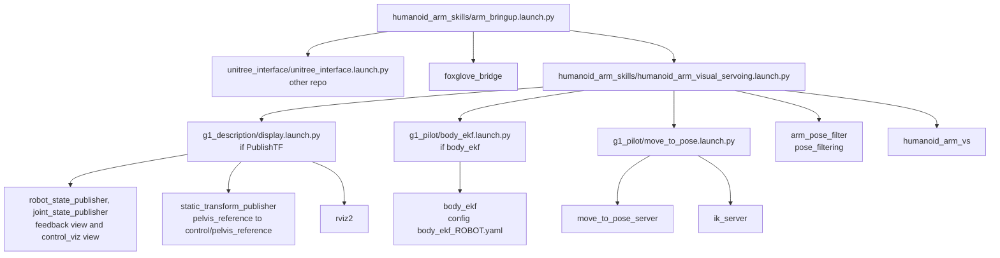
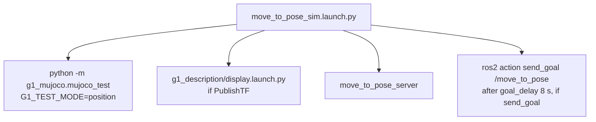
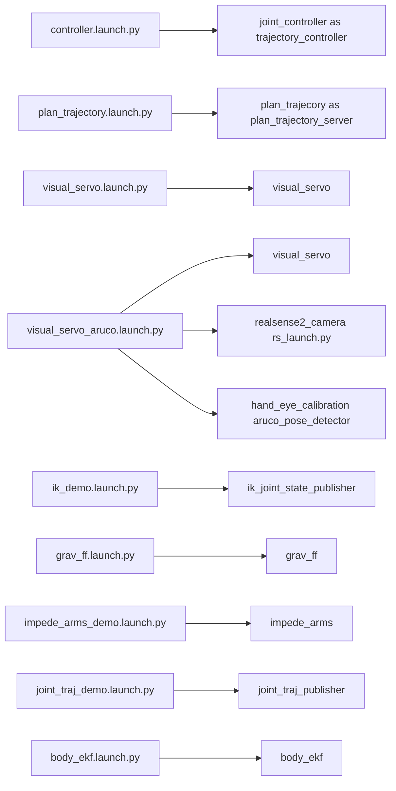

# Launch files

Every launch file in the repo, what it includes and which nodes it starts. Use `arm_bringup.launch.py` on the robot and `move_to_pose_sim.launch.py` against the MuJoCo sim.

## The press stack

`arm_bringup.launch.py` is the arm-only entry point. It brings up nothing from navigation or perception.

Pass `PublishTF:=false` on the robot, where there is no display. `body_ekf.launch.py` loads `config/body_ekf_<robot>.yaml`; only `stanley` has a file in the repo.

## Key launch arguments

The press launch forwards most arguments to its includes. Defaults below come from `humanoid_arm_visual_servoing.launch.py`.

| Argument | Default | Goes to |
|---|---|---|
| `normal_pose_topic` | `track_3d/selected_normal_pose` | filter input; `_filtered/arm` output; `_filtered/arm_upright` skill input |
| `target_frame_arm` | `foot_world` | filter frame and `move_to_pose_server` `planning_frame` |
| `filter_type` | `kalman` | filter, with `filter_alpha` and the `kf_*` noise values |
| `move_to_pose_action` | `/move_to_pose` | server action name and skill client |
| `arm_safety_distance_x`, `_y`, `_z` | `0.0` | `move_to_pose_server` and `ik_server` press offset |
| `feedback_topic`, `position_control_topic`, `traj_topic` | `feedback`, `position_control`, `traj` | `move_to_pose_server` (feedback also to `ik_server`) |
| `body_ekf` | `true` | starts `body_ekf` |
| `PublishTF` | `true` | starts `display.launch.py` |

`move_to_pose.launch.py` alone defaults `planning_frame` to `left_ankle_roll_link` and `check_reach_service` to `/check_reach`.

## Simulation

`move_to_pose_sim.launch.py` runs the planner against the MuJoCo sim in position mode. It can send one goal after a delay.

The sim speaks `/position_control` and `/feedback`. This launch starts no `ik_server`.

## Demos and older tools

The remaining `g1_pilot` launch files each start one node, most with `display.launch.py` when `PublishTF` is true.

`visual_servo.launch.py` remaps the right-arm goal topic to `/track_3d/selected_normal_pose_filtered/arm_upright`, the filtered pose the press stack uses.
