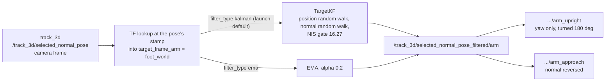
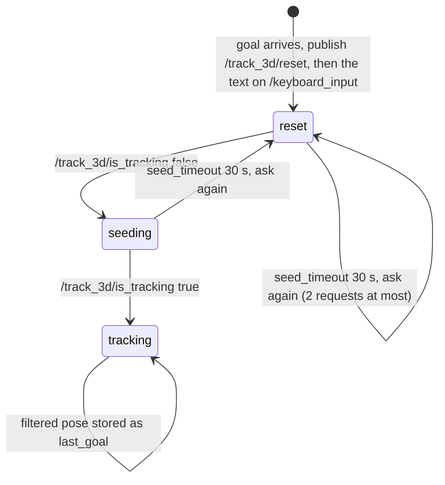
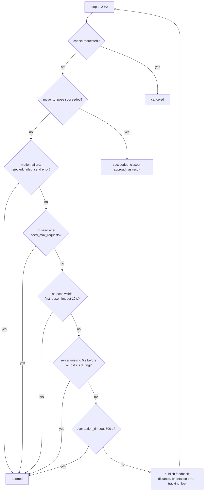
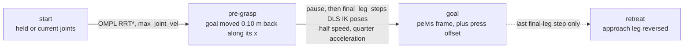
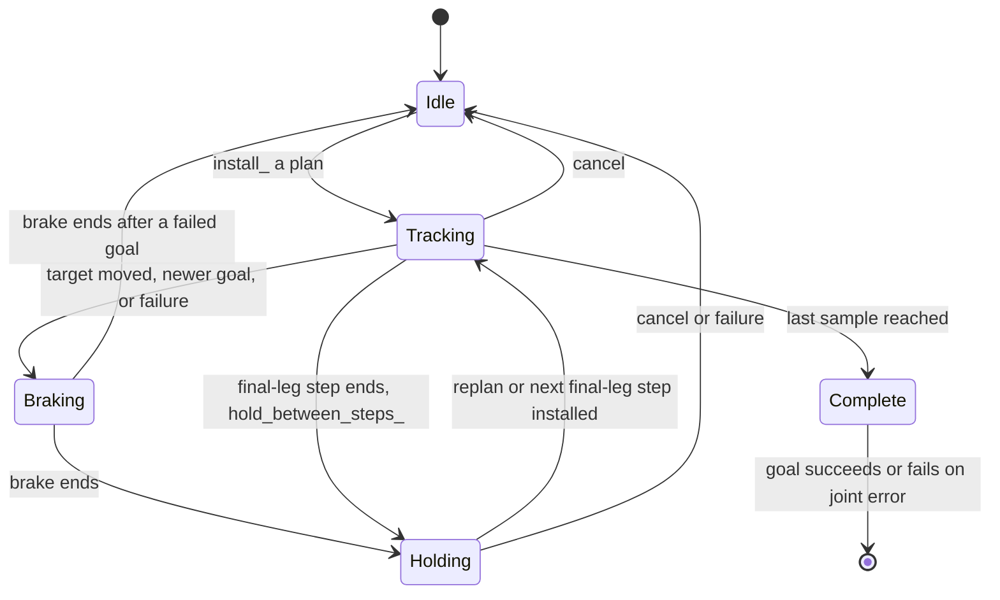
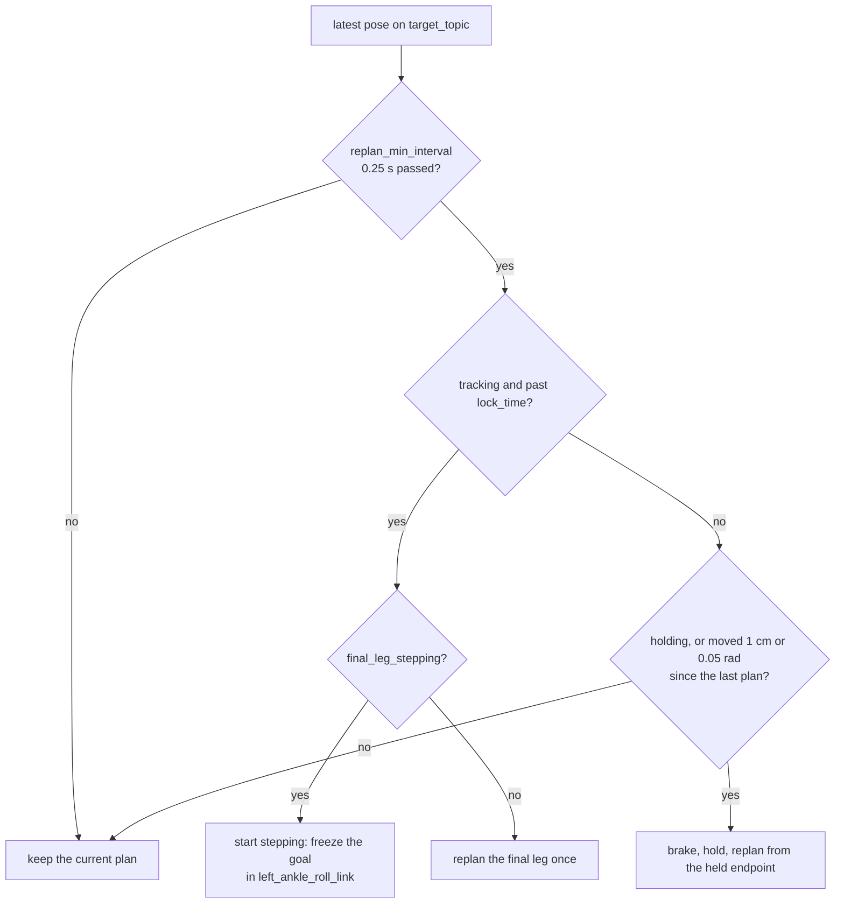

# Press pipeline

How a press goal becomes arm motion: the target filter, the skill's seeding, the planned trajectory's shape and the control modes of `move_to_pose_server`. Read [System](system.md) first for the topic names.

## Target path

The tracker's surface pose reaches the planner through one filter. The filter moves it into `foot_world`, smooths it and publishes three variants.

A pose without a stamp, a TF miss or an outlier is dropped. A gap over `lost_timeout` (5 s), a frame change or a `/reset_filter` message restarts the filter.

## Skill goal and seeding

`humanoid_arm_vs` accepts one goal at a time. It asks the tracker for the target by text, then waits for a fresh track before it trusts any pose.

Poses count only in `tracking` while `require_seed` is true. The first stored pose triggers the single MoveToPose goal.

## Skill goal outcomes

The skill loop runs at `goal_rate` (2 Hz) and ends the goal on the first matching rule. Every exit cancels all `move_to_pose` goals and resets the tracker.

The result reports the closest approach of `left_ee` or `right_ee` to the goal. A press ends with a retreat, so the last pose would understate the reach.

## Planned trajectory

`VisualServoPlanner` plans in joint space to a pre-grasp, then walks a straight approach leg to the goal. The target locks once the approach leg starts.

`lock_time` marks the start of the approach leg. `replanTrajectory` reuses the cached path and recomputes only the approach leg when the goal moved a little and the arm stayed near the path.

## Control modes of move_to_pose

The 100 Hz control timer acts on one mode. The worker thread moves the node between modes as targets update and steps finish.

`Tracking` and `Braking` publish the current trajectory sample with inverse-dynamics feedforward torque. `Holding` republishes the endpoint with zero velocity.

## Replanning and the final leg

The worker checks the live target every `feedback_period` (0.1 s). What it does depends on where the arm is in the plan.

Each of the 10 final-leg steps waits for the hold and a 0.5 s settle. It re-maps the frozen goal into the current pelvis and subtracts the depth-fitted gripper error.

## Failure rules of move_to_pose

A goal fails fast when its inputs go stale or the arm stops following. Near the target, a large joint error counts as pressing and is allowed.

| Rule | Parameter (default) | Effect |
|---|---|---|
| Joint feedback older than the limit | `feedback_timeout` (0.5 s) | goal aborts at once |
| One joint off its command while tracking | `max_tracking_error` (0.2 rad) for `tracking_error_timeout` (1 s) | goal aborts, unless the tip is within `near_target_distance` (2 cm) |
| Plan ends outside the goal tolerance | `goal_position_tolerance` (5 mm), `goal_orientation_tolerance` (0.1 rad) | first plan aborts; replans count as failures |
| Replan or final-leg step fails repeatedly | `max_plan_failures` (3) | goal aborts |
| Gripper estimate stale or implausible | `gripper_estimate_max_age` (0.5 s), `gripper_estimate_max_error` (3 cm) | correction is skipped |

`ik_server` applies the same plan and tolerance check without moving the arm. The orchestrator's `check_reach` uses it before a press.
