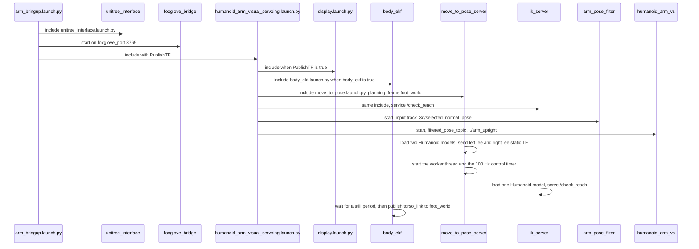
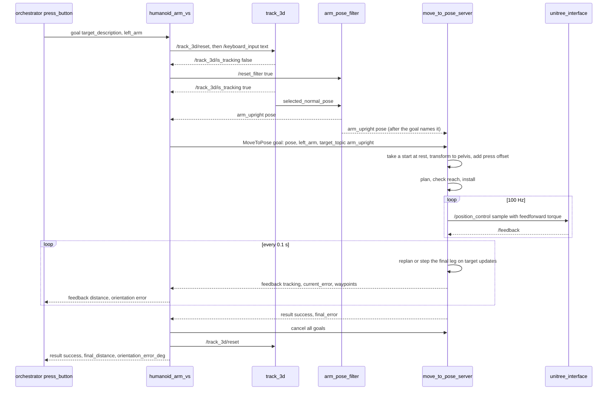
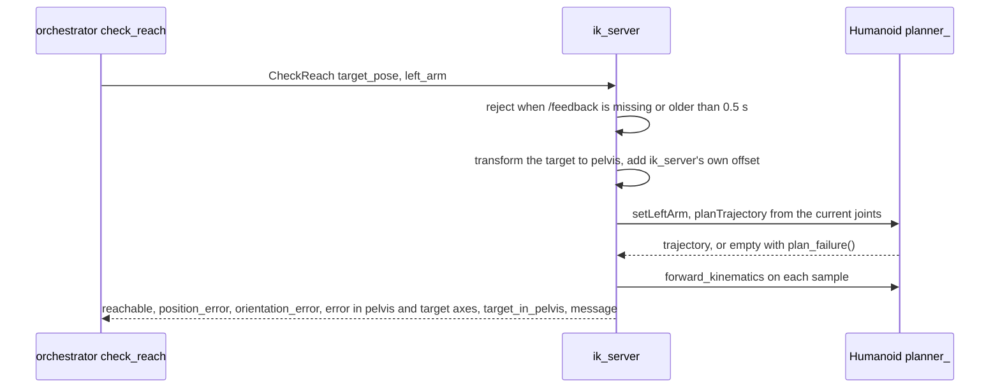
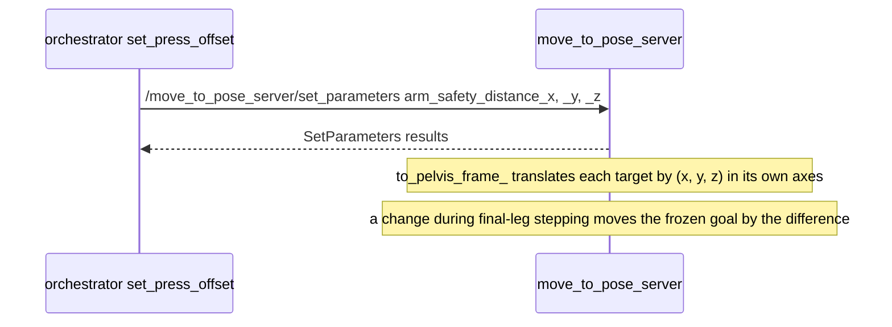

# Sequences

How the arm stack starts, how a press goal unfolds and how the orchestrator's reach check and press offset reach the planner. Read [Classes and ownership](classes.md) for the objects named here.

## Startup

`arm_bringup.launch.py` starts the robot interface, the viewer bridge and the press stack. Launch starts the actions of a file in list order, and each node then initialises on its own.

`move_to_pose_server` refuses to plan until it has fresh `/feedback`. Arm targets need `foot_world`, so `body_ekf` must calibrate before the first press.

## A press goal

The orchestrator sends one VisualServoingArm goal. The skill seeds the tracker, hands one MoveToPose goal to the planner and waits for its result.

A failed MoveToPose result aborts the press with its message. The cancel-all request stops any motion the skill started, even one whose acceptance it never saw.

## The reach check

The orchestrator asks `ik_server` whether the arm reaches a target. The service plans as `move_to_pose_server` would and commands nothing.

`reachable` uses the same 5 mm and 0.1 rad tolerances as `move_to_pose_server`. `ik_server` keeps its launch-time offset, so the orchestrator adds the press offset to the target itself.

## Setting the press offset

The orchestrator sets three parameters on `move_to_pose_server`. The node reads them at every plan, so the next press uses them.

The values live only in the running node. A relaunch resets them to the launch arguments, which default to zero.
