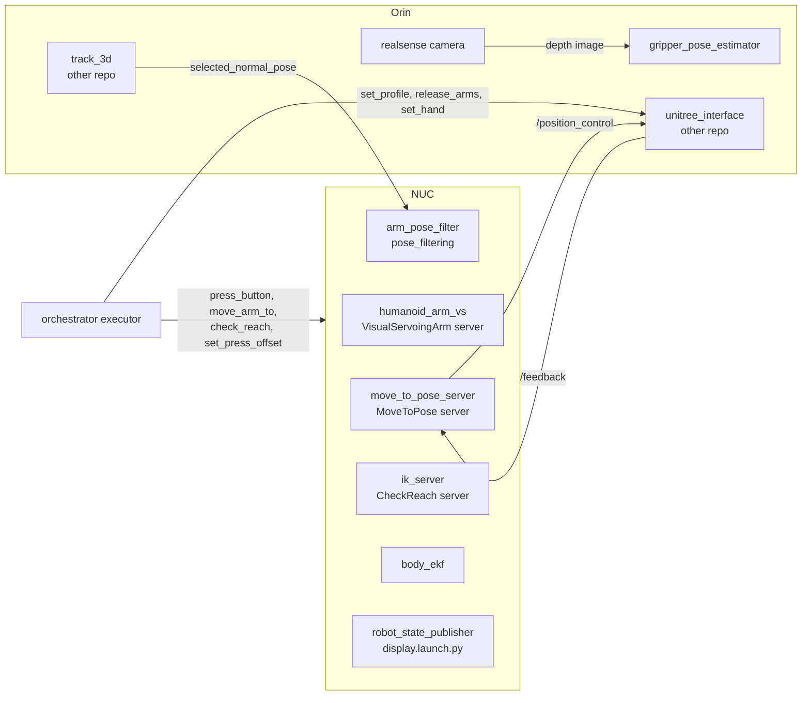
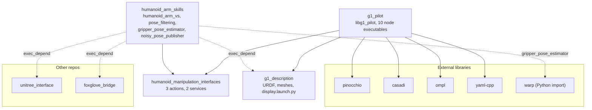
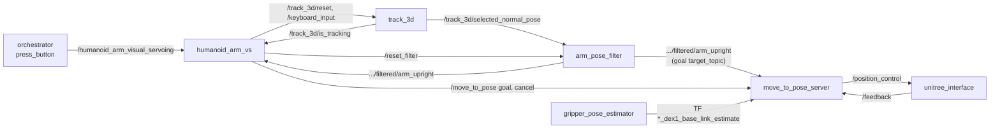

# System

The machines, the four packages, and every ROS interface the arm stack offers or uses. The interface table at the end is the contract the orchestrator relies on.

## Deployment

The NUC runs the arm stack. The Orin runs the camera, the tracker and the robot interface that drives the motors.

The orchestrator contracts place the four arm skills on the NUC and the unitree_interface services on the Orin. The tracker and gripper estimator placement comes from the orchestrator's system page; this repo does not pin a machine or ROS distro.

## Packages

`g1_pilot` holds the C++ library and its nodes. `humanoid_arm_skills` holds the Python press skill, the target filter and the gripper estimator.

Solid arrows are build dependencies from `package.xml` and `CMakeLists.txt`. `warp` is imported by `gripper_pose_estimator.py` but is not listed in `package.xml`.

## The press graph

A press goal crosses three nodes of this repo. The tracker and the robot interface live in other repos.

`humanoid_arm_vs` sends one MoveToPose goal and names the filtered topic as its `target_topic`. `move_to_pose_server` then reads that topic itself and replans as the target moves.

## Interfaces

Names are as launched by `humanoid_arm_visual_servoing.launch.py` with an empty namespace. Relative names in the code resolve to the root namespace there.

| Name | Kind | Type | Served or published by | Used by |
|---|---|---|---|---|
| `/humanoid_arm_visual_servoing` | action | `humanoid_manipulation_interfaces/action/VisualServoingArm` | `humanoid_arm_vs` | orchestrator `press_button` |
| `/move_to_pose` | action | `humanoid_manipulation_interfaces/action/MoveToPose` | `move_to_pose_server` | `humanoid_arm_vs`; orchestrator `move_arm_to`; `move_to_pose_sim.launch.py` |
| `/move_to_pose/_action/cancel_goal` | service | `action_msgs/srv/CancelGoal` | `move_to_pose_server` (action server) | `humanoid_arm_vs`, an empty request cancels every goal |
| `/check_reach` | service | `humanoid_manipulation_interfaces/srv/CheckReach` | `ik_server` | orchestrator `check_reach` |
| `/move_to_pose_server/set_parameters` | service | `rcl_interfaces/srv/SetParameters` | `move_to_pose_server` (parameter service) | orchestrator `set_press_offset`: `arm_safety_distance_x`, `_y`, `_z` |
| `/unitree_interface/set_profile` | service | `unitree_interface_msgs/srv/SetProfile` | `unitree_interface`, other repo | orchestrator `set_profile` |
| `/unitree_interface/release_arms` | service | `std_srvs/srv/Trigger` | `unitree_interface`, other repo | orchestrator `release_arms` |
| `/unitree_interface/set_hand_pose` | service | `unitree_interface_msgs/srv/SetHandPose` | `unitree_interface`, other repo | orchestrator `set_hand` |
| `/body_ekf/reset` | service | `std_srvs/srv/Trigger` | `body_ekf` | no caller in this repo |
| `trajectory_controller` | action | `humanoid_manipulation_interfaces/action/ControlJointTrajectory` | `joint_controller` | no caller in this repo |
| `plan_trajectory` | service | `humanoid_manipulation_interfaces/srv/PlanJointTrajectory` | `plan_trajecory` | no caller in this repo |
| `/position_control` | topic | `sensor_msgs/msg/JointState` | `move_to_pose_server`; also `joint_controller`, `visual_servo`, `joint_traj_publisher`, `ik_joint_state_publisher` | `unitree_interface`; `display.launch.py` control view |
| `/feedback` | topic | `sensor_msgs/msg/JointState` | `unitree_interface` | `move_to_pose_server`, `ik_server`, `display.launch.py`, the other C++ nodes |
| `/traj` | topic | `nav_msgs/msg/Path` | `move_to_pose_server`; also `joint_traj_publisher`, `visual_servo`, `plan_trajecory` | RViz (`manipulation.rviz`) |
| `/track_3d/selected_normal_pose` | topic | `geometry_msgs/msg/PoseStamped` | `track_3d`, other repo | `arm_pose_filter` |
| `/track_3d/selected_normal_pose_filtered/arm` | topic | `geometry_msgs/msg/PoseStamped` | `arm_pose_filter` | no subscriber in this repo |
| `/track_3d/selected_normal_pose_filtered/arm_upright` | topic | `geometry_msgs/msg/PoseStamped` | `arm_pose_filter` | `humanoid_arm_vs`; `move_to_pose_server` during a press; orchestrator `check_reach` |
| `/track_3d/selected_normal_pose_filtered/arm_approach` | topic | `geometry_msgs/msg/PoseStamped` | `arm_pose_filter` | `humanoid_arm_vs` with its default parameter only |
| `/track_3d/is_tracking` | topic | `std_msgs/msg/Bool` | `track_3d`, other repo | `humanoid_arm_vs` |
| `/track_3d/reset` | topic | `std_msgs/msg/Empty` | `humanoid_arm_vs` | `track_3d`, other repo |
| `/keyboard_input` | topic | `std_msgs/msg/String` | `humanoid_arm_vs` | the tracker's seeding, other repo |
| `/reset_filter` | topic | `std_msgs/msg/Bool` | `humanoid_arm_vs` | `arm_pose_filter` |
| `/pelvis_imu`, `/torso_imu` | topic | `sensor_msgs/msg/Imu` | robot interface (unverified) | `body_ekf` |
| `/body_ekf/torso_pose` | topic | `geometry_msgs/msg/PoseStamped` | `body_ekf` | no subscriber in this repo |
| `left_gripper_pose`, `right_gripper_pose` | topic | `geometry_msgs/msg/PoseStamped` | `gripper_pose_estimator` | no subscriber in this repo |
| `/camera/camera/depth/image_rect_raw`, `.../camera_info` | topic | `sensor_msgs/msg/Image`, `CameraInfo` | realsense camera | `gripper_pose_estimator` |
| TF `torso_link` to `foot_world` | TF | `tf2_msgs/msg/TFMessage` | `body_ekf` | `arm_pose_filter`, `move_to_pose_server` (planning frame) |
| TF `left_ee`, `right_ee` | static TF | `tf2_msgs/msg/TFMessage` | `move_to_pose_server`, `joint_controller`, `visual_servo` | `humanoid_arm_vs` errors; orchestrator `press_button` capture |
| TF `left_dex1_base_link_estimate`, `right_...` | TF | `tf2_msgs/msg/TFMessage` | `gripper_pose_estimator` | `move_to_pose_server` final leg |

The `arm_upright` pose keeps the position and takes a yaw-only orientation, turned 180 degrees from the normal's heading. `move_to_pose_server` plans in `pelvis` and publishes `/traj` in `planning_frame`, which the press launch sets to `foot_world`.
